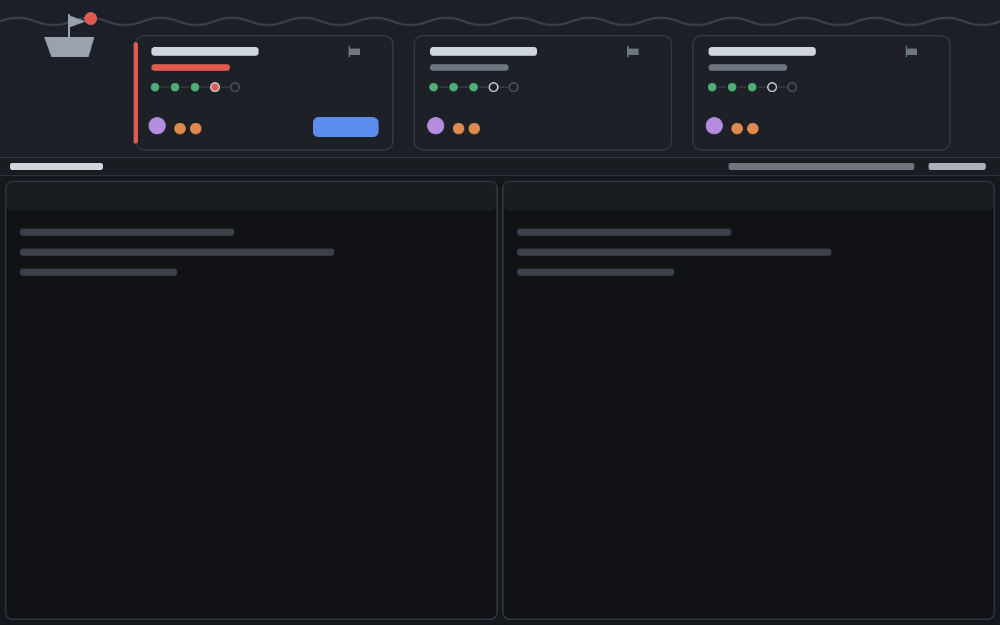

# Harbormaster: see your runs in the Herdr app

Harbormaster is a Herdr app mod with two layouts. It shows what `herdr-app-captain` and its `herdr-app-orchestrator` runs are doing, so you don't have to read the Agents list row by row. Everything in it is written from scratch: it uses Herdr's mod API and leaves Herdr's own mods and layouts unchanged.

- **Crew block.** The 🧑‍✈️ captain and every 🐙 orchestrator, as cards with a colored edge, then **Adrift**: every other agent, on any machine, that isn't one of their workers. It sits above Herdr's own Agents list. The captain's and each orchestrator's card shows how full that agent's context is (`144k`), as of its last turn, read from its own session file: Claude Code, pi and opencode (needs `python3`), nothing for other programs. A card whose agent (with the commands it runs) uses more than 50% CPU or 2 GB of memory gets a small `85% · 2.1G` badge, with what uses it on hover, and for an orchestrator the whole run's use too; see [CPU and memory](#cpu-and-memory).
  - The captain's card says whether its watcher is running and how many runs it watches, running and finished, and turns red with how many decisions it is waiting on you for. Clicking it focuses the captain and opens the runs overview beside it, if it isn't open already.
  - Each orchestrator's card is named for what the run is about, with a tag for its type (`feat`, `fix`, `rev` or `expl`): the issue or PR number from its branch and the short topic its orchestrator published (`feat` `#985 · Road routes`, `rev` `PR 368 · Triage decision`), with the full branch in the tooltip. Run cards and the harbor's signs show the type the same way. A run with no topic yet, such as one started before orchestrators published one, shows its branch. The name gets the card's whole first line. The line below starts with the type tag and the number of 🦀 workers, then its progress, its status when it isn't running, and its PRs, so a narrow sidebar cuts the progress short before the tag and workers. A run that needs you turns red and says what for. Finished ones come last, with a green edge and their PR numbers. Clicking it focuses the orchestrator and opens that run's card beside it (see below), if it isn't open already. Clicking a card never closes its pane; close it like any pane.
  - Each Adrift line shows the agent's space and its name as Herdr's own Agents list gives it: the tab's name when someone named it, otherwise the agent's own title (Claude Code sets one from its session), never a bare tab number like "1". Clicking it focuses the agent.
- **Runs overview.** The totals across runs on top (running, need you, finished, agents, tasks done, open PRs and failing checks; "need you" counts the captain's open decisions and the runs that need you, and clicking it focuses the first of them), then **Waiting on you**, then the captain, then one card per run:
  - its name, as in the Crew block, and repository, a status pill, the progress line, and a task bar from `plan.md` (hover a segment for its task), with the tasks done and those under way counted by stage below it (`21/22 done · 1 in review`), colored by each task's stage: planned, implementing, in review, fixing, done or blocked (a task is done once it is merged into the run's integration branch). Tasks are read from `### <id> <name> — <state>` headings (or with a `Status:` in or below them), from a table with an `id`, `#` or `task` column and a `status` column, or from list items under `## Tasks` with a `Status:`. The stage comes from the task's state words; when they name none, or say it is still planned, from the run's live agents working on it, matched by name (`impl-<prefix>-<task>`, `rev-…`, `fix-…`, and `grunt-…` (a command-watching agent, shown as implementing), with the run's `Prefix:` from `plan.md`);
  - every PR the run opened, with its state, checks and review (who approved it or asked for changes), and below them its related links: its issues, and the PRs it is about but did not open, such as the PR a review-only run reviews (their icon takes the PR's state color; they don't count as open PRs);
  - what the run needs you for, shown first: its open question, the dialog it is blocked on, or the reason in its status;
  - and, when they apply: relayed messages the orchestrator hasn't read, agents waiting on an answer, "No pull request yet", and a note when the run's orchestrator is gone;
  - a pin, while its orchestrator is there, that keeps this card open as a pane beside the orchestrator;
  - buttons to **Park**, **Resume**, **Close**, or, once closed, **Delete** the run (see Parked, resumed, and closed runs). Each asks on the card first, naming what is left.

  **Waiting on you** is one queue of everything you have yet to decide, across all runs and machines, so a question doesn't get lost when alerts and reports pile up after it. It is sorted by how long the work has been blocked, oldest first (a run's question by when its `question.md` was written, a captain decision by when it was asked). Each item says what it asks, which run, how long ago, and, when the question has them, the recommended option with why, the evidence and the risk, so you can answer from there. It has one button per option, with the recommended one starred, and **Reply** for your own words. A button or Reply writes your answer to the run's `inbox/` as a `.message` and wakes its orchestrator, the same way Close does and the captain relays; the item then reads "Answered, waiting for the orchestrator" until the question goes away (an unhandled message someone else left in the run's inbox shows as "Message waiting for the orchestrator" and hides the buttons, but Reply stays). A captain decision answers to the captain's input as `Re decision "<id>" (<question>): <answer>` when the captain is there; without it, when the decision names a run, to that run's inbox, and Harbormaster then removes that decision from `.captain-decisions.json` on the run's machine, since no captain is there to; otherwise Reply is disabled and says why. Runs that need you without a question (a dialog, a blocked status) stay in the queue and click through to their orchestrator. Questions in the older free-form shape still work, with Reply only. The file formats are in [the run files reference](../skills/herdr-app-orchestrator/references/run-files.md). Clicking an item's text focuses the captain or the orchestrator. The queue is hidden while nothing is waiting.

  Clicking a card focuses the orchestrator. Clicking a PR or issue opens it in the browser. Finished runs stay, after the running ones, until you close their orchestrator's tab. Parked runs come next, under **Parked**. Closed runs fold away at the bottom. Each group lists the newest first: running runs by when they started (so cards don't move while they work), finished ones by their last update, parked and closed ones by when they were parked or closed. Runs started before Harbormaster recorded start times sort by their last update.
- **`harbormaster-main` layout.** Herdr's main layout with the Crew block added.
- **`harbormaster-sea` layout** (fun):
  - The captain rides a boat on the surface and drops anchor while watching. The captain calls "Ahoy!" when it has a decision for you or a run needs you, and raises the anchor and naps when nothing is being watched.
  - Each run is a reef with its type and name on a sign. A finished run's reef goes quiet, its octopus asleep and its PR flags up, until you close the orchestrator's tab; then it leaves the harbor. A parked run keeps its reef, dimmed and without its octopus. Clicking a parked reef, or one whose orchestrator is gone, offers to resume it. A run that needs you says what for in a bubble. The orchestrator is an octopus and its workers are crabs. Working crabs scuttle, blocked ones jump, and crabs whose turn is done sleep.
  - Buoys along the bottom are the run's tasks and turn green as they merge.
  - Signal flags on the mast are its PRs. Clicking one opens it.
  - Agents outside any run drift on the right, named as in the Crew block. The active tab's terminals sit below deck.
  - While it shows, `alt-up` / `alt-down` step through agents in the harbor's order (captain, each run's octopus and crabs, then drifters), through Herdr's `setAgentOrder`. Other layouts set their own order again.

The skills work the same with or without any of this. Tested with Herdr 0.1.12.



## Install

Needs `jq`. Run this from any terminal while the Herdr app is open, in a checkout of this repository:

```sh
herdr-app/install.sh
```

It does four things:
- copies `herdr-app/mods/harbormaster` and the sea layout into the app's home (`~/.config/herdr-app`, or `$HERDR_APP_HOME`). It refuses to replace a mod or layout of the same name that isn't Harbormaster's, as Herdr asks. It removes the `harbormaster-board` layout earlier versions installed, if it is Harbormaster's;
- clones your Herdr's `main` layout as `harbormaster-main`, and inserts the Crew block above its Agents block with `jq`;
- binds `ctrl-shift-h` to `mod.open:harbormaster` under `global` in `keys.json`. It skips this and tells you how to add a key yourself if `ctrl-shift-h` is already bound in any section, or if there is no `keys.json` yet;
- runs `herdr-app check` on the mod.

To update, pull and run it again. It overwrites the mod and the sea layout. It leaves `harbormaster-main` alone once it has the Crew block, and the key binding alone once it exists.

Note: install copies files and deletes only what earlier versions of Harbormaster installed and it knows about (`board.js` and the `harbormaster-board` layout). Any other file removed from the mod in a later version stays in `mods/harbormaster` until you delete it.

To switch layouts, press `ctrl-shift-l`. You can also run `herdr-app do layout.switch '{"name":"harbormaster-sea"}'`, with any of `harbormaster-main`, `harbormaster-sea`, or Herdr's own `main`. The sea has a "Back to main" button.

To glance at the runs from anywhere, press `ctrl-shift-h`. It opens the overview as a popup over the window, and pressing it again, or Esc, closes it.

To keep the overview open beside the captain, click **Pin beside captain** on the captain's card in the overview (or click the captain's Crew card, which only opens it). It opens a `harbormaster` pane to the right of the captain's terminal, in the captain's tab, and is saved with that tab. The same button then says **Unpin** and closes it. While the captain's terminal isn't on screen (for example, parked), the button is greyed out and its tooltip says why. You can also close the pane like any pane: its header, or `ctrl-shift-x` while it has focus.

To see a run's PRs, related PRs, issues and tasks while you work in its orchestrator, click the pin on the run's card in the overview, or click the orchestrator's Crew card, which only opens it. It opens a `harbormaster` pane right of the orchestrator's terminal, in its tab, showing only that run, laid out for the room: its PRs with their whole titles, repository, checks and review; its issues and related PRs one per row; the task bar (hover a segment for its task and stage), with the tasks done and those under way counted by stage beside the Tasks heading (`20/22 done · 1 fixing`); the agents working on it, each with the task its name says it works on (`impl-<prefix>-<task>`) and that task's stage, and the helpers they started indented below them (click one to peek at it over the tab, or to focus it when it has a pane); and the same buttons. While that pane has focus, the orchestrator's Crew card stays highlighted. Pressing the pin again (it is on the pinned card too) closes it. Like the captain's, it is saved with the tab, and greyed out while the orchestrator's terminal isn't on screen. A resumed run gets a new orchestrator tab, so pin it again there. The pane follows its orchestrator, so it keeps showing the run when the orchestrator moves it to a new integration branch, and it shows the same run on every computer whose window shows that tab. A pane whose run is gone has a **Close this pane** button.

To use the Crew block in a layout of your own, add a block with `{ "mod": "harbormaster", "props": { "role": "crew" } }`.

To see where time, tokens and CPU go, click **Stats** at the top of the overview. It opens the stats view in a tab of its own named Stats (or shows the one already open). To put it in a layout or pane of your own, use `{ "mod": "harbormaster", "props": { "role": "stats" } }`. Add `"run": "<run directory>"` (`~` allowed) to open it on one run: that run first, unfolded, with its tasks unfolded. See [Stats](#stats).

## Another computer, connected over ssh

Layouts and mods belong to the window, not to the machine the agents run on. Say a laptop adds this machine with Add machine (`hc machine add`). It sees this machine's spaces and terminals, but draws them with the laptop's own `~/.config/herdr-app`. So **install on every computer whose window you use**: clone this repository there and run `herdr-app/install.sh`.

Harbormaster is built for that:
- It reads run directories and asks `gh` on every connected machine (`exec(..., {on: machine})`). So the laptop shows the desktop's runs, with a machine tag on each card.
- It opens links on the computer you are looking at (`open` on macOS, `xdg-open` on Linux).
- `gh` must be logged in on the machine where the runs live, not where the window is.
- The orchestrators and the captain run `herdr-app` to open and close spaces and tabs, and it reaches only a window on their own computer. On the machine where the runs live, there is none, so after a Close they leave the integration worktree's space and their own tab. Harbormaster closes both in your window once the run has its `closed` marker, and closes the space before the orchestrator deletes the worktree. Without Harbormaster in the window, close them by hand.
- For the same reason, an orchestrator on another computer cannot rename its tab when its status changes (`🐙`, `🐙 ✋` or `🐙 ✓`, then the run's type and topic, such as `🐙 rev · Triage decision`, or its branch before it has a topic). Harbormaster renames it in your window from the run's `plan.md` and `status.json`, unless you gave the tab a name of your own. Without Harbormaster, the tab keeps its old name.
- Nor can it open its integration worktree's space. Harbormaster opens it in your window, nested under the repository's space, and switches back to the space you were on. It opens each worktree's space once, so one you close stays closed, until the run is parked or closed and resumed. Without Harbormaster, open it with the worktree menu's Open worktree.
- A captain on another computer has the same limits. Harbormaster names its tab `⚓ captain` (unless the tab has a name already), and when the captain parks a run there, which writes the `parked` marker but cannot reach your window, Harbormaster closes the run's integration worktree spaces and the orchestrator's tab, as its own Park does. It does that only for a run it saw open with its orchestrator there, so runs parked before stay as they are.

## What it reads

The mod runs programs and reads files outside its folder. Herdr's AGENTS.md asks mods to list those, so here they are:

- **Every 5 seconds, per machine:** one `sh -c` script. It prints the captain's open decisions, `.captain-decisions.json` in the runs root, then for each run under `~/.herdr/hc-orchestration/*/*/` (or `$HERDR_ORCHESTRATION_ROOT`), it prints `orchestrator.json`, `status.json` (with the token totals `tokens.sh` counted; Harbormaster never reads session files for them), `plan.md`, `question.md` and its modification time (`stat`), and the `parked` and `closed` markers, counts the unhandled `inbox/*.message` files, and prints `proof.md` and the names of the files in `shared/proof/` (at most 40), and the last 60 `- [decided]` and `- [user]` lines of `decisions.md` (`grep`, `tail`, capped at 20 kB), and `.resources.json`. The same script then takes one process snapshot for [CPU and memory](#cpu-and-memory): on Linux one `awk` over `/proc/*/stat`, the environment of herdr-core's children and the command lines of the processes it prints; on macOS `ps` twice.
- **Every minute per open run (running or finished), every 15 minutes per closed one:** `gh pr view <url>` for each PR and related PR in `status.json`, on the run's machine. A run shows only the PRs its orchestrator recorded there. A PR's `## Merge danger` first line (from its body) is kept with the result and shown on its row: red for a one-way door, dim for a two-way one (see `skills/herdr-app-orchestrator/references/run-files.md`). The results are kept in Herdr's shared state (`harbormaster.prs`), so every copy of the mod and every layout uses the same ones.
- **When you press Park or Close:** `git worktree list` in the run's folder, to find the integration worktrees whose spaces to close.
- **Every 30 seconds per open run on another machine, with its orchestrator there:** the same `git worktree list`, to find the integration worktrees to open spaces for. The worktrees it has opened or seen open are kept in Herdr's shared state (`harbormaster.worktrees`).
- **Every 5 seconds per closed run with a space still on one of its worktree folders:** one `sh -c` that checks whether those folders still exist, so it closes only the spaces whose folder is gone.
- **Live from herdr-core:** the terminal labels `role`, `run.status`, `run.type`, `run.topic`, `progress` and `run.prs`, and the `captain-watch` terminal.

- **When a proof thumbnail is shown or opened:** `stat` and `cp` on this computer, or on the run's machine `stat` and `base64`, of that one file (see Proof); the copies are written under `mods/harbormaster/.cache/` in the app's home. A video opens with `xdg-open` (`open` on macOS).
- **When you answer from the queue:** a run's answer is a file in its `inbox/`, then `hc send` to wake its orchestrator (not when the orchestrator is gone or lost: the message only waits). A captain decision answered into a run's inbox is then removed from `.captain-decisions.json` in the runs root with `jq`, a temporary file and `mv`.
- **When you press Compact on the budget question:** `hc send <orchestrator> /compact`, then a `sleep 2` loop (for at most 10 minutes) until the compaction is over, then the wake-up for the answer.

When a run closes, or just before you delete it, it also appends a summary of the run (time by category, tokens, CPU and memory, per agent and task) as one line to `.history.jsonl` in the runs root (`~/.herdr/hc-orchestration`) of the run's machine, so its numbers outlive it; the format is in `skills/herdr-app-orchestrator/references/run-files.md`. It writes to a run directory on its own only `.resources.json`, every 5 seconds per open run whose orchestrator is there (a temporary file and `mv`, under a `.resources.json.lock` directory). Otherwise it writes to one only when you press Park, Close or Delete, or answer a question (and, for a captain decision answered into a run's inbox, to `.captain-decisions.json` in the runs root): one `parked` or `closed` file, with the time and the plan's status then, the same marker the captain writes, or for Close with the orchestrator there, a message in the run's `inbox/`, as the captain relays them. An answer from the queue is a message there too (`<time>-<ms>-harbormaster.message`). Delete removes the run directory, and this computer's copies of its proof images.

It changes the window on its own only for a closed run (a `closed` marker): it closes spaces still on one of the run's `~/.herdr/worktrees/<repo>/<branch>` folders once that folder is gone, and the orchestrator's tab once its turn has ended; and for an open run on another machine: it renames the orchestrator's tab after the run's status, when the tab is unnamed or has one of the orchestrator's own `🐙` names, at most once a minute, opens a space for each integration worktree that has never had one, and finishes parking a run the captain parked there; and names a captain's tab on another machine `⚓ captain`.

## Autonomy and decided for you

`set-status.sh --autonomy L0|L1|L2` (default `L0`) says how much an orchestrator decides itself:
`L0` you approve decisions, `L1` it decides small things and stops for direction or design calls,
`L2` it runs to a merge-ready PR with proof and stops at merge. A run's card and pane show it as a
small tag by the name (`L1`; hover for what it means); the narrow Crew block leaves it out so the
type tag and agent count keep their room. Every decision an orchestrator makes itself is a
`- [decided] <UTC time> <topic>: <decision> — <why>` line in `decisions.md`. The overview card shows
one summary line, "Decided for you · 20 by the orchestrator, 1 from you · latest: …" (counts of `[decided]`
and `[user]` lines, the newest of either), with all of them in the tooltip. The run pane has the same line; click it
to list every decision (up to the last 60 lines) with when it was made and why, newest first, and again to collapse
(not remembered). A line that does not parse is shown as its raw text. Formats: [run-files.md](../skills/herdr-app-orchestrator/references/run-files.md).

## Tokens

How many tokens a run has used, across its orchestrator and every agent it ran, counted by
`skills/herdr-app-orchestrator/scripts/tokens.sh` into the run's `status.json` (`tokens`). The
orchestrator does not run it itself: `set-status.sh` runs it on every publish, and later runs read only
what the session files gained since, so it stays cheap. It reads Claude Code's, pi's and opencode's own session
files on the orchestrator's computer, from the run's start on, including those of agents already
killed and worktrees already removed, those of an orchestrator resumed in a new terminal (best effort
for a pi or opencode orchestrator), and, from its cache, those Claude Code has since deleted; a count never goes
down. A run's card shows the total in its
meta line (`26M tok`); the run pane has a **Tokens** section with the split (fresh tokens, meaning input, output and cache writes, in
blue; cache reads in green) and each agent's share as a stacked bar in the same colours, with the exact numbers on
hover (`fresh 1,234,567 (in 12, out 3,456, cache write 1,230,000) · cache read 28,000,000`), the orchestrator
first, then the agents by size, named by their worktree (`pda-t3`). The narrow Crew block leaves it
out; hovering an orchestrator's context size there shows the run total too. A token is any of input,
output, cache read and cache write, so the total is dominated by cache reads: it measures how much the
run has processed, not what it cost. Harbormaster itself reads only `status.json`, so the numbers show
for a run on another machine and stay once the orchestrator is gone. How runs, sessions and messages
are matched: [run-files.md](../skills/herdr-app-orchestrator/references/run-files.md).

### Soft budget

`set-status.sh --budget 30M` (also `500k`, `1.5M` or a plain number) gives a run a soft token budget,
which the orchestrator sets when started with `budget=30M`. Cache reads count in the total and dominate it: a
run of a few tasks is tens of millions, so pick a budget in that range, not a few million. A run that has used it shows `31M / 30M tok` in
the blocked colour on its card and a note in its Tokens section, from `status.json` alone. The
orchestrator asks a budget question when it notices (Continue, Compact or Stop; at any autonomy level),
which shows in Waiting on you like any other. A run over budget with no question open, whose orchestrator is gone, idle or done (not working, and not
needing you for another reason), and whose question is not marked answered (`--budget-answered`), gets the same
three buttons from Harbormaster itself. **Compact** types `/compact` into the orchestrator's terminal,
enabled only while it is idle or done, waits for the compaction to end, and wakes it to read the answer in its inbox; the other two answer through the
inbox. Nothing stops by itself. Details: [run-files.md](../skills/herdr-app-orchestrator/references/run-files.md).

## CPU and memory

Who is busy right now, and what each agent, task and run used, from the same 5-second poll: nothing new
keeps running. Each herdr-core terminal's processes are found from its own process (a child of
`herdr-core hold`, by the `HC_TERMINAL_ID` in its environment) down through everything it started, and split
into the agent's own process and its commands, named by program from a small table in `resources.js`
(`PROGRAMS`: test runner, browser, lint, install, build, mcp server, docker, git, shell; else the program's
own name, such as `node` or `php`).

- **Badges.** A Crew card or an agent row in the run pane, and an agent adrift, gets a small `85% · 2.1G`
  badge only above 50% CPU (100% is one core) or 2 GB of memory (`HOT` in `resources.js`); hover it for the
  agent's own share and its busiest programs. An orchestrator's Crew card is badged on its own process
  and commands, like any agent; its tooltip adds the whole run's use (the orchestrator and its agents).
- **Run totals.** For each open run whose orchestrator is there, each sample is added to
  `.resources.json` in the run directory: per agent (named as its terminal, so per task through
  `impl-<prefix>-<task>`) its CPU seconds and peak and average memory, split by program, and the run's
  own. They outlive the agents, the run and the app; the stats view and the run history read them.
  Formats: [run-files.md](../skills/herdr-app-orchestrator/references/run-files.md).
- **Others.** The busiest processes outside every agent (a browser left open, Docker, the Herdr app
  itself) are kept in the live snapshot too, so fan noise can always be explained.

On **Linux** CPU time comes from `/proc/<pid>/stat`, including the time of commands that already exited
(`cutime`, `cstime`), and the CPU % from the difference between two polls, so the first poll shows memory only.
On **macOS** it is one `ps` sample: CPU % is `ps`'s own, and CPU totals are each live process's time,
so commands that ended between two polls are missed (`estimated` in the file). Other systems show nothing.
While the app is closed nothing is sampled, so peaks then are missed. The cost, measured on this
machine with about 290 processes: the snapshot adds about 10 ms of CPU to each 5-second poll (the whole
script about 90 ms), reading it about 0.3 ms in the app, and each run's write a few ms.

## Where the time went

`herdr-app/mods/harbormaster/timing.sh` works out where a run's time went, after the fact, from
logs that already exist: the orchestrator's and every agent's Claude Code, pi or opencode session,
found as `tokens.sh` finds them (so after the agents and their worktrees are gone too). The
orchestrator spends nothing on it. Each tool call is sorted into a category (test, lint/typecheck,
build, install, CI wait, agent wait, review, git, other), the time between tool calls is model
time, and the orchestrator waiting for an answer to its `question.md` is user wait. It gives, as
JSON (the format is at the top of the script), the run's wall time; `critical_path`, where that
time went: the orchestrator's own time by category plus its idle time, which add up to its part of
the wall time; and the effort: time per category, per agent (with its role: impl, rev, fix) and
per task, whose sums exceed the wall time, as agents work in parallel. Each transcript's events and
result are cached in the run's `.timing/` folder, so an unchanged run is read again in well under a
second, and a live run's transcripts are read only from where the last read stopped. `timing.js`
runs it on the run's own machine.

The rules that sort tool calls are a small table, `herdr-app/mods/harbormaster/categories.tsv`:
one rule a line, a category, a tool name pattern and a command pattern, the first match wins. A
call gets one category: of the commands in a shell call, the first that is not git or other. Edit
it in the repository and run `install.sh` again (an edit in the installed copy is overwritten on the
next install).

## Stats

The stats view (`props.role` `stats`) gathers the figures above for every run on every machine:
open runs from their logs (`timing.sh`), `.resources.json` and `status.json`, and past runs from
`.history.jsonl`, newest first. A closed run that is in the history shows its history line once; an open
one (or one resumed after it was recorded) shows its live figures. It adds nothing to run cards. Each
section folds with a click on its title.

- **Where the time goes.** The runs' `critical_path` summed: where the orchestrators' wall time went, by
  category (model, test, lint/typecheck, build, install, CI wait, agent wait, review, git, user wait,
  other) plus idle, as one stacked bar with each category's share and time. **By repo** and **By type**
  give a bar per repository or run type instead, as long as its total. Hover a segment for its time.
- **CPU and memory now.** Every agent terminal from the last 5-second sample, under its orchestrator (and
  the captain), with CPU % (100% is one core), memory, and its busiest commands; then the terminals in no
  run, then **Other processes**: the busiest processes outside every agent (a browser, Docker, Herdr
  itself), so fan noise can be explained. Hover a row for the agent's own share and each program, and
  its terminal's name. Terminals in no run under 1% CPU and 100 MB (idle shells) are one "+N more" line.
- **Runs.** Per run: its wall time, a bar of where it went, its tokens (a bar as wide as its share of
  the largest run's, as on run cards: fresh tokens, that is input, output and cache writes, in blue, cache reads in green;
  exact numbers on hover), and its CPU time and memory peak (all its agents together). Click a run for
  the categories with shares, the effort (all agents' time, more than the wall time as they work in
  parallel), CPU by program, and its tasks: each with its effort by category, CPU and memory peak; click
  a task for its agents, each with its role, time, CPU and peak. An agent's CPU includes the commands it
  started with `hc run`; its memory peak is its largest terminal's. A task's peak is its largest agent's.

Timing is read in the background, one run at a time: an open run's at most every 90 seconds (open runs
already read come first, so a first read of another run does not hold them up), a parked or closed run's
once, and a run the history already has not at all. A big run's first read can take a minute or more (its
later reads are quick, from `timing.sh`'s cache); until then it shows "reading…". An open run's figures,
its wall time included, are as of that last read, so they can be up to two minutes behind. The history
is read again every minute, the live table with each 5-second poll. The newest 25 runs are listed;
**Show N older** lists the rest (the sums across runs always count them all).

Which agent and task a terminal's CPU and memory count for is one rule (`attribute.js`), the same for
open runs and history lines: the agent whose brief named it; for the commands an agent started with
`hc run`, that agent; for a terminal timing does not know (a grunt, an agent whose session was not read
yet), a row of its own, its task from its name (`impl-<prefix>-<task>`).

## Proof

A run's pane has a Proof section. Its top line is the verdict, for example `Proof T2 · 6/8 pass · 2
partial (2 tasks without a screenshot) · checks green · two-way door`: the run's tier (plan.md's `Proof tier:`
line, else the highest among the tasks), passes over the tasks that have a `Proof:` line or a proof.md
entry, fails and partials, tasks of tier T2 or higher with a result whose `Files:` list has no existing image or video ("n tasks without a
screenshot": it counts tasks, not images; proof.md is read up to 64 kB, and the verdict says "(proof.md cut)" past that), the `Checks: green|red` line of proof.md, and the merge danger of the run's PR (`two-way
door` or `one-way door`). It is in the blocked colour for a fail, red checks or a one-way door, green
when everything passes, dim otherwise. Below it is one compact row per task: tier, name and a pass,
partial, fail, not checked or not scoped pill, and small thumbnails of the task's images from its proof.md
`Files:` (the first three, then `+n`; a `▶` box for a video: mp4, webm, mov, m4v). A thumbnail click opens the
screenshot in a Harbormaster overlay, scaled to fit, with its file name, `‹` `›` for the task's other images and
Esc or ✕ to close. A video opens in the system player. A file over 6 MB is not copied (see below) and says "too
large to preview".
Click a row to see its evidence, "Checked:", "Result:" and files. A running run shows the rows; once it
is finished, parked or closed the section starts collapsed to the verdict line (click it to expand;
not remembered). Two links open `proof.md` and the
`shared/proof/` folder; for a run on another machine they are shown as paths, since nothing here
can open a file there. In the runs overview, a run's card carries a small tier tag by its name
(hover for how many tasks are not scoped) and "n unscoped" in its meta line. The formats are in
[run-files.md](../skills/herdr-app-orchestrator/references/run-files.md).

### Where the screenshots come from

The app can only draw images from its own folder, and a run on another machine keeps its files there, so
Harbormaster copies a file the first time its thumbnail is shown: on this computer with `cp`, for a run on
another machine with `base64` through the connection (`exec` with `on:`), decoded here. Files over 6 MB (base64
of that nears the connection's 8 MiB output limit) are not copied. The copy is made in the background and the
thumbnail shows `…` meanwhile, or `big` for a refused file; a file that changed (size or time) is copied again, a
shown one is looked at again once a minute. Copies live in `mods/harbormaster/.cache/<machine or local>/<run>/`
in the app's home (a hidden folder, so saving into it doesn't reload the mod), and a run's folder is removed when
you Delete the run, alone or with Delete older than. A run an agent or a script deleted by hand leaves its copies
until you delete the folder. `install.sh` copies only the mod's `*.js`, `*.svg` and `mod.json`, so it neither
ships nor wipes the cache. A video on this computer opens from the run folder without a copy; one from another
machine is copied first (same limit) and the copy opens.

### Popup of a run's pane, for screenshots

An agent that has to show a run's pane in a screenshot (the proving skill's T2 for a Herdr mod) opens it as a brief centered dialog,
without switching your space or tab, takes the shot and closes it:

```sh
herdr-app do 'harbormaster.show-run:<branch>'   # or the run's directory, or its orchestrator's terminal
sleep 1; herdr-app shot proof.png
herdr-app do 'harbormaster.close-popup'
```

`show-run` with no name shows the newest run that isn't parked or closed. A popup is one at a time (a second
`show-run` replaces it) and closes itself after a minute if nobody closes it. The commands reach a shown
Harbormaster that isn't the dialog itself (the Crew block of `harbormaster-main`, or the open overview); with none on screen they do nothing. The dialog is a centered one, not a pointer popup, which has nowhere to appear without a pointer.

## Parked, resumed, and closed runs

An orchestrator sets `finished` once its work is done, its PRs are up and their CI is green. The run stays open: in every view, in the captain's `runs.sh`, and on the captain's watch. It is **closed** once its orchestrator's terminal is gone, which is when you close its tab.

Before that, you can put a run away yourself, with the card's buttons or by asking the captain:

- **Park** sets a run aside for later: an unfinished one, or a finished one still waiting on something, such as review or QA before its PR merges. It writes `parked`, closes the spaces of its integration worktrees, and closes the orchestrator's tab, which ends it and its agents. The worktrees stay, and Resume opens their spaces again. The run stays in the overview under **Parked** and as a dimmed reef in the sea, but needs nothing: the captain's watcher stays quiet about it.
- **Close** ends a run for good, finished or not, and cleans up after it. It asks the orchestrator, with a message in its inbox, to do it, and once the message is in and the orchestrator isn't blocked on a dialog, closes the integration worktree's space before the orchestrator deletes the worktree. The orchestrator ends its agents, pushes any code that isn't on the remote yet, deletes the run's worktrees whole (ignored files such as `.env`, dependencies and builds go with them), deletes the task branches whose work is on the integration branch, writes `closed`, and closes its own tab. A finished run whose orchestrator is idle and whose worktrees are already gone has nothing left to clean up: Close writes `closed` and closes its tab right away. The integration branch, branches with work of their own, PRs and the run directory stay. If it can't push something, it asks you rather than delete it. Once a run has its `closed` marker, Harbormaster closes what the orchestrator left in the window: spaces still on a worktree folder of the run that is gone, and the orchestrator's tab once its turn has ended (never while it is working or blocked). An orchestrator can close them itself only when the window is on its own computer (see Another computer, connected over ssh). When the orchestrator is gone, Close only writes `closed`, and closes its tab if it is lost (see below); resume the run and close it again to clean up. The run folds away with the other closed runs.
- **Resume** brings back a parked, closed, or gone run. It starts a new orchestrator of the run's kind with the resume command, in a new tab in the repository's own space, the space on its main checkout, never the integration worktree's. If that space is not open, it opens one for the repository with the orchestrator as its first tab. The orchestrator deletes the marker, restarts unfinished tasks from their worktrees, and opens the integration worktree under the repository's space again.

- **Delete** removes a closed run for good: its run directory, with its spec, plan, decisions and status, goes, so it leaves every view and the captain's lists and can't be resumed. Branches and PRs stay. It refuses while a worktree still has the integration branch checked out, as when the run was closed with its orchestrator gone: resume it and close it again to clean up, then delete it. To clear out several at once, unfold the closed runs and pick **Delete older than** 1 week, 30 days, or all: it asks first, naming how many runs on which machines, then deletes each one on its own machine as Delete does, and lists any it could not delete and why. Age is from when the run was closed (its last update for a closed run without a `closed` marker).

Parking leaves the run directory, worktrees, branches and PRs in place, and the repository's own space; closing keeps the run directory, the branches with work and the PRs. An unfinished run whose orchestrator is gone without a marker, because its tab was closed some other way or it crashed, shows as gone. So does a run whose orchestrator is lost, finished or not: its terminal and tab are still there but only a shell runs in it, as herdr-core leaves agents' terminals after the machine restarts (it keeps terminals, not their programs), or after the agent exited. A lost finished run stays among the finished ones rather than closing, since its tab is open; resuming it closes that tab. A gone run's card offers Resume, Park and Close. The captain asks you about an unfinished one, one run at a time: resume it, park it, or close it. A lost finished run needs nothing, so the captain mentions it once.

"Needs you" means an open question, a blocker, or a dialog, never a finished run, and the views show which.

## Files

| Path | What |
| --- | --- |
| `herdr-app/mods/harbormaster/main.js` | Picks the view by `props().role`: none (the runs overview), `run` (one run's card, `props().run` its key), `crew`, `harbor`, `harbor-rail`, `harbor-pane`, `stats` |
| `herdr-app/mods/harbormaster/data.js` | Run directories, tasks, PRs from `gh`, and the totals the views share |
| `herdr-app/mods/harbormaster/live.js` | Live facts from herdr-core (status, workers, captain, panes) and the focus, pin and open-link actions |
| `herdr-app/mods/harbormaster/ui.js` | Emoji, program icons, zoom, and text formatting |
| `herdr-app/mods/harbormaster/overview.js` | The runs overview (totals, captain, run cards) and the Crew block |
| `herdr-app/mods/harbormaster/resources.js` | CPU and memory: the process snapshot, the live usage and badges, and each run's `.resources.json` |
| `herdr-app/mods/harbormaster/context.js` | Each crew agent's context size, from its session file, and `tokenText` (`1.2M`) |
| `herdr-app/mods/harbormaster/timing.sh`, `categories.tsv` | Where a run's time went, from its session logs, and the table that sorts tool calls into categories |
| `herdr-app/mods/harbormaster/timing.js` | Runs `timing.sh` on the run's machine (`loadTiming(run)`), cached per run; category labels and `durationText` |
| `herdr-app/mods/harbormaster/history.js` | Appends a closed run's summary to `.history.jsonl` (`writeHistory`, once per closing; `writeHistoryBeforeDelete`) |
| `herdr-app/mods/harbormaster/attribute.js` | Which agent and task each terminal's CPU and memory count for, for the stats view and the history |
| `herdr-app/mods/harbormaster/stats.js`, `statsdata.js` | The stats view, and its figures: open and past runs in one shape, the sums across runs, the live table's groups |
| `herdr-app/mods/harbormaster/harbor.js` | The sea, the reefs, the captain's boat, the rail and the pane headers |
| `herdr-app/mods/harbormaster/*.svg` | Art and icons: captain, octopus, crab, sleeping crab, anchor, seabed, waves, PR, pin, spinner, chevrons. All original, CC0 like the rest of this repository |
| `herdr-app/layouts/harbormaster-sea.json` (+ `.svg` preview) | The sea layout. `harbormaster-main` is made by `install.sh` |
| `herdr-app/install.sh` | Install or update |

## Remove

1. Switch to `main`.
2. Delete these from the app's home: `mods/harbormaster`, and `layouts/harbormaster-*`.
3. In `keys.json`, delete the `"ctrl-shift-h": "mod.open:harbormaster"` line (or whichever key you bound to it).
4. Close any `harbormaster` pane still beside the captain.
