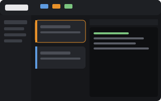
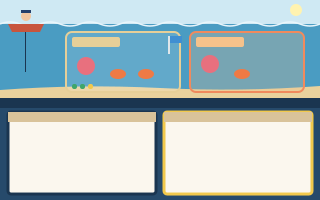

# Harbormaster: see your runs in the Herdr app

Harbormaster is a Herdr app mod with three layouts. It shows what `herdr-app-captain` and its `herdr-app-orchestrator` runs are doing, so you don't have to read the Agents list row by row. Everything in it is written from scratch: it uses Herdr's mod API and leaves Herdr's own mods and layouts unchanged.

- **Crew block.** The 🧑‍✈️ captain and every 🐙 orchestrator, as cards with a colored edge. It sits above Herdr's own Agents list.
  - The captain's card says whether its watcher is running and how many unfinished runs it watches. Its pane button pins the runs overview beside the captain, or unpins it.
  - Each orchestrator's card shows its progress, its status when it isn't running, its number of 🦀 workers and its number of PRs. A run that needs you turns red.
- **Runs overview.** One card per run:
  - its branch and repository, a status pill, the progress line, and a task bar from `plan.md` (merged, in progress, blocked);
  - its issues, and every PR with its state, checks and review decision;
  - an open question, shown first when the run is waiting for you;
  - and, when they apply: relayed messages the orchestrator hasn't read, agents waiting on an answer, "No pull request yet", and a hint to ask the captain to resume a run whose orchestrator is gone.

  Clicking a card focuses the orchestrator. Clicking a PR or issue opens it in the browser. Finished runs fold away at the bottom.
- **`harbormaster-main` layout.** Herdr's main layout with the Crew block added.
- **`harbormaster-board` layout** (serious):
  - a summary bar (runs, need you, agents, tasks merged, open PRs, failing checks);
  - the Crew block above the Agents list;
  - the runs overview;
  - the focused agent's live terminal.
- **`harbormaster-sea` layout** (fun):
  - The captain rides a boat on the surface and drops anchor while watching. The captain calls "Ahoy!" when a run needs you, and raises the anchor and naps when nothing is being watched.
  - Each unfinished run is a reef with its branch on a sign; finished runs leave the harbor. The orchestrator is an octopus and its workers are crabs. Working crabs scuttle, blocked ones jump, and crabs whose turn is done sleep.
  - Buoys along the bottom are the run's tasks and turn green as they merge.
  - Signal flags on the mast are its PRs. Clicking one opens it.
  - Agents outside any run drift on the right. The active tab's terminals sit below deck.
  - While it shows, `alt-up` / `alt-down` step through agents in the harbor's order (captain, each run's octopus and crabs, then drifters), through Herdr's `setAgentOrder`. Other layouts set their own order again.

The skills work the same with or without any of this. Tested with Herdr 0.1.12.

 

## Install

Needs `jq`. Run this from any terminal while the Herdr app is open, in a checkout of this repository:

```sh
herdr-app/install.sh
```

It does three things:
- copies `herdr-app/mods/harbormaster` and the board and sea layouts into the app's home (`~/.config/herdr-app`, or `$HERDR_APP_HOME`);
- clones your Herdr's `main` layout as `harbormaster-main`, and inserts the Crew block above its Agents block with `jq`;
- binds `ctrl-shift-h` to `mod.open:harbormaster` in `keys.json`, unless that key is already taken (then it tells you);
- runs `herdr-app check` on the mod.

To update, pull and run it again. It overwrites the mod and the two layouts. It leaves `harbormaster-main` alone once it has the Crew block, and the key binding alone once it exists.

To switch layouts, press `ctrl-shift-l`. You can also run `herdr-app do layout.switch '{"name":"harbormaster-board"}'`, with any of `harbormaster-main`, `harbormaster-board`, `harbormaster-sea`, or Herdr's own `main`. The board has a "Back to main" button and the sea has a "Run board" button.

To glance at the runs from anywhere, press `ctrl-shift-h`. It opens the overview as a popup over the window, and pressing it again, or Esc, closes it.

To keep the overview open beside the captain, click **Pin beside captain** on the captain's card in the overview (or the pane icon on the captain's Crew card). It opens a `harbormaster` pane to the right of the captain's terminal, in the captain's tab, and is saved with that tab. The same button then says **Unpin** and closes it. You can also close it like any pane: its header, or `ctrl-shift-x` while it has focus.

To use the Crew block in a layout of your own, add a block with `{ "mod": "harbormaster", "props": { "role": "crew" } }`.

## Another computer, connected over ssh

Layouts and mods belong to the window, not to the machine the agents run on. Say a laptop adds this machine with Add machine (`hc machine add`). It sees this machine's spaces and terminals, but draws them with the laptop's own `~/.config/herdr-app`. So **install on every computer whose window you use**: clone this repository there and run `herdr-app/install.sh`.

Harbormaster is built for that:
- It reads run directories and asks `gh` on every connected machine (`exec(..., {on: machine})`). So the laptop shows the desktop's runs, with a machine tag on each card.
- It opens links on the computer you are looking at (`open` on macOS, `xdg-open` on Linux).
- `gh` must be logged in on the machine where the runs live, not where the window is.

## What it reads

The mod runs programs and reads files outside its folder. Herdr's AGENTS.md asks mods to list those, so here they are:

- **Every 5 seconds, per machine:** one `sh -c` script. For each run under `~/.herdr/hc-orchestration/*/*/` (or `$HERDR_ORCHESTRATION_ROOT`), it prints `orchestrator.json`, `status.json`, `plan.md` and `question.md`, and counts the unhandled `inbox/*.message` files.
- **Every minute per running run, every 15 minutes per finished one:**
  - `gh pr view <url>` for each PR in `status.json`;
  - `gh pr list --head <branch>` in the run's folder, so a PR shows up before the orchestrator records it.

  The results are kept in Herdr's shared state (`harbormaster.prs`), so every copy of the mod and every layout uses the same ones.
- **Live from herdr-core:** the terminal labels `role`, `run.status`, `progress` and `run.prs`, and the `captain-watch` terminal.

It never writes to run directories.

## Files

| Path | What |
| --- | --- |
| `herdr-app/mods/harbormaster/main.js` | Picks the view by `props().role`: none (run cards), `crew`, `summary`, `focus-rail`, `harbor`, `harbor-rail`, `harbor-pane` |
| `herdr-app/mods/harbormaster/data.js` | Reads run directories, PRs and live facts (orchestrator state, workers, captain) |
| `herdr-app/mods/harbormaster/board.js` | Run cards, the Crew block, the summary bar, the focused-agent rail |
| `herdr-app/mods/harbormaster/harbor.js` | The sea, the reefs, the captain's boat, the rail and the pane headers |
| `herdr-app/mods/harbormaster/*.svg` | Art and icons: captain, octopus, crab, sleeping crab, anchor, seabed, waves, PR, pin, spinner, chevrons. All original, CC0 like the rest of this repository |
| `herdr-app/layouts/harbormaster-board.json`, `harbormaster-sea.json` (+ `.svg` previews) | The two standalone layouts. `harbormaster-main` is made by `install.sh` |
| `herdr-app/install.sh` | Install or update |

## Remove

1. Switch to `main`.
2. Delete these from the app's home: `mods/harbormaster`, and `layouts/harbormaster-*`.
