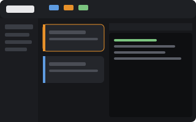
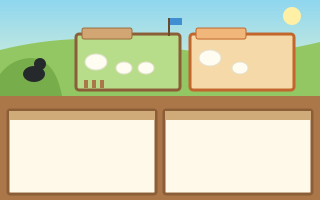

# The runs view for the Herdr app

Everything here shows what `herdr-app-captain` and its `herdr-app-orchestrator` runs are doing, without reading the Agents list row by row:

- **Agents list (`agents-runs`).** ⚓ Captain first, then 🐙 Orchestrators from every space, each as a tinted card with a colored edge. The captain's card says whether its watcher runs and how many runs it watches. Each orchestrator's card shows its `progress`, its status when not running, and its PR count, with its workers nested underneath. Pinned agents and everything else follow as before.
- **Runs overview (`runs` mod).** One card per run: branch and repository, a status pill, the progress line, a task bar from `plan.md` (merged, in progress, blocked), the issues, and every PR with its state, checks and review decision. A run waiting for you shows its open question first. Clicking a card focuses the orchestrator, and clicking a PR or issue opens it in the browser. Finished runs fold away at the bottom.
- **`runs-board` layout** (serious). A summary bar across the top (runs, need you, agents, tasks merged, open PRs, failing checks), the Agents list, the runs overview, and the focused agent's live terminal.
- **`runs-pasture` layout** (fun, after Herdr's [Pasture](https://herdr.dev/layouts/herdrdev/pasture)). The captain is a sheepdog on the hill that barks when a run needs you and naps when nothing is being watched. Each run is a fenced pen with its branch on a sign, the orchestrator as the bellwether and its workers as the flock. Working sheep wander, blocked ones jump, finished ones sleep. Fence posts are the run's tasks and turn green as they merge. Flags on the gate are its PRs, and clicking one opens it. Agents outside runs graze as strays, and the active tab's terminals sit in the workshed below.

The skills work the same with or without any of this. Tested with Herdr 0.1.12.

 

## Install

From any terminal while the Herdr app is open, in a checkout of this repository:

```sh
herdr-app/install.sh                 # mods and layouts
herdr-app/install.sh --captain-pane  # also opens the overview beside the captain now
```

It copies `herdr-app/mods/runs` and the two layouts into the app's home (`~/.config/herdr-app`, or `$HERDR_APP_HOME`). It clones Herdr's `agents` mod as `agents-runs` and applies `herdr-app/agents-runs.patch`; an older `agents-runs` (for example from [the earlier steps](herdr-app-agents-view.md)) is moved aside to `~/.config/herdr-app/agents-runs.backup-<time>` first. If there is no `main-runs` layout, it clones `main` as one and points its Agents block at `agents-runs`. Finally it runs `herdr-app check` on both mods. Run it again after pulling to update. The runs mod and layouts are overwritten, and `agents-runs` is re-patched only when it lacks the current changes.

Switch layouts with `ctrl-shift-l`, or `herdr-app do layout.switch '{"name":"runs-board"}'` (also `runs-pasture`, `main-runs`, or `main` for Herdr's own). The board has a "Back to main" button, and the pasture's rail has a "Run board" button.

To show the overview beside the captain at any time, run `herdr-app/captain-pane.sh`. It splits a `runs` pane to the right of the terminal labelled `role=captain`. Close it like any pane. It is saved with the captain's tab.

## Another computer, connected over ssh

Layouts and mods belong to the window, not the machine the agents run on. A laptop that adds this machine with Add machine (`hc machine add`) sees its spaces and terminals, but draws them with the laptop's own `~/.config/herdr-app`. So **install on every computer whose window you use**: clone this repository there and run `herdr-app/install.sh`.

The runs mod is built for that. It reads run directories and asks `gh` on every connected machine (`exec(..., {on: machine})`), so the laptop shows the runs on the desktop, with a machine tag on each card. It opens links on the computer you are looking at (`open` on macOS, `xdg-open` on Linux). `gh` must be logged in on the machine where the runs live, not where the window is.

## What it reads

The runs mod runs programs and reads files outside its folder; as Herdr's AGENTS.md asks, here is what:

- every 5 seconds, per machine: `sh -c` that prints each `~/.herdr/hc-orchestration/*/*/` (or `$HERDR_ORCHESTRATION_ROOT`) run's `orchestrator.json`, `status.json`, `plan.md`, `question.md` and the count of unhandled `inbox/*.message` files;
- every minute per running run, every 15 minutes per finished one: `gh pr view <url>` for each PR in `status.json`, and `gh pr list --head <branch>` in the run's folder, so a PR shows before the orchestrator records it. Results are kept in Herdr's shared state (`runs.prs`), so several copies and layouts share them;
- live terminal labels from herdr-core: `role`, `run.status`, `progress`, `run.prs`, and the `captain-watch` terminal.

It never writes to run directories.

## Files

| Path | What |
| --- | --- |
| `herdr-app/mods/runs/main.js` | Picks the view by `props().role`: none (cards), `summary`, `focus-rail`, `pasture`, `pasture-rail`, `pasture-pane` |
| `herdr-app/mods/runs/data.js` | Run directories, PRs, and live facts (orchestrator state, workers, captain) |
| `herdr-app/mods/runs/board.js` | Cards, the summary bar, the focused-agent rail |
| `herdr-app/mods/runs/pasture.js` | The meadow, pens, sheepdog, rail and pane headers |
| `herdr-app/mods/runs/*.svg` | Art: `meadow`, `dog` and `pr` are original; `sheep`, `graze` and `sleep` are from Herdr's Pasture example (Apache-2.0, see `NOTICE`) |
| `herdr-app/layouts/runs-board.json`, `runs-pasture.json` (+ `.svg` previews) | The two layouts |
| `herdr-app/agents-runs.patch` | The changes to Herdr's `agents` mod (0.1.12) |
| `herdr-app/install.sh`, `captain-pane.sh` | Install, and open the overview beside the captain |

## On a newer Herdr

If `install.sh` says the patch does not fit, Herdr changed its Agents list. The runs mod and layouts are installed anyway. For `agents-runs`, give an agent in the app this prompt:

> Clone the `agents` mod as `agents-runs` (move any existing `mods/agents-runs` out of `mods/` first) and point the `main-runs` layout's Agents block at it, cloning `main` as `main-runs` if it is missing. In the mod, read each terminal's labels from `terminals()`. Show agents with `role=captain` in a group "⚓ Captain" at the very top, then agents with `role=orchestrator` from every space in a group "🐙 Orchestrators", each row naming its space the way pinned rows do and keeping its sub-agents nested under it. Draw those rows as cards tinted with a 3px colored left edge: accent for the captain; working, done or blocked for an orchestrator by its `run.status` label (`running`, `finished`, anything else). Under the row put one muted line: for the captain "on watch · N runs" (N orchestrators), or "not watching runs" in the blocked color when no live terminal is named `captain-watch`; for an orchestrator its `progress` label and, if `run.prs` lists any, "· N PRs", after a small pill with `run.status` when it is not `running`. Make those two group headers foreground-colored and semibold. Pinned agents and the rest stay unchanged. Run `herdr-app check` on the mod when done.

## Remove

Delete `mods/runs`, `mods/agents-runs`, and `layouts/runs-board.*`, `runs-pasture.*`, `main-runs.json` from the app's home, after switching to `main`.
